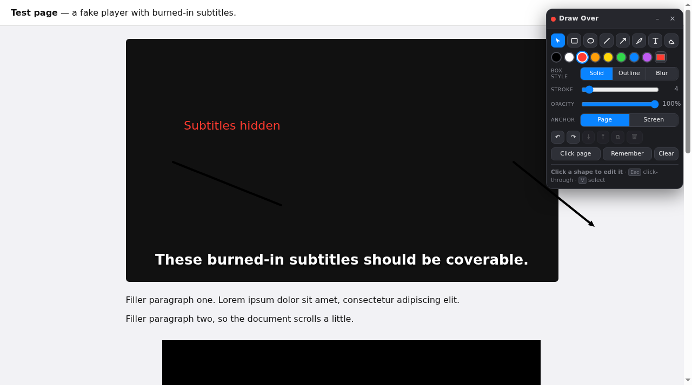

# Draw Over

A Chrome and Firefox extension that puts a drawing surface on top of any web page.

It was built for a specific annoyance — **covering burned-in subtitles on a video** — so a
solid black rectangle is the default tool, and every shape stays editable: click it, drag it,
pull a handle to resize. Nothing is baked in until you say so.



## Install

Build the two loadable folders first:

```sh
./build.sh          # -> dist/chrome, dist/firefox (+ matching .zip files)
```

**Chrome / Edge / Brave** — `chrome://extensions` → enable *Developer mode* →
*Load unpacked* → pick `dist/chrome`.

**Firefox** — `about:debugging#/runtime/this-firefox` → *Load Temporary Add-on* →
pick `dist/firefox/manifest.json`. Temporary add-ons are removed when Firefox restarts;
for a permanent install the package has to be signed through addons.mozilla.org.

## Using it

Click the toolbar button (or press <kbd>Alt</kbd>+<kbd>Shift</kbd>+<kbd>D</kbd>) and the
overlay appears with its own floating panel. The panel is draggable by its title bar and
collapses with the **–** button.

**To cover subtitles:** the rectangle tool and solid black are already selected — just drag a
box over them. The moment you release, the extension switches to the select tool with that
box active, so you can nudge it into place immediately.

The toolbar button cycles **off → drawing → click-through → off**, so a second press parks
your drawings and hands the page back to you rather than wiping them.

### Tools

| | Tool | Key | |
|---|---|---|---|
| ↖ | Select & edit | <kbd>V</kbd> | drag to move, handles to resize, <kbd>⇧</kbd> keeps the aspect ratio |
| ▭ | Rectangle | <kbd>R</kbd> | solid, outline, or blur |
| ◯ | Ellipse | <kbd>O</kbd> | |
| ╱ | Line | <kbd>L</kbd> | <kbd>⇧</kbd> snaps to 45° |
| ↗ | Arrow | <kbd>A</kbd> | |
| ✎ | Free draw | <kbd>P</kbd> | freehand pen, smoothed |
| T | Text | <kbd>T</kbd> | double-click (or <kbd>Enter</kbd>) to re-edit; <kbd>Esc</kbd> commits |
| ⌫ | Erase | <kbd>E</kbd> | click or drag across shapes to remove them |

### Keys

| | |
|---|---|
| <kbd>Alt</kbd>+<kbd>Shift</kbd>+<kbd>D</kbd> | overlay on / off |
| <kbd>Alt</kbd>+<kbd>Shift</kbd>+<kbd>X</kbd> | click-through — use the page, keep the drawings |
| <kbd>Alt</kbd>+<kbd>Shift</kbd>+<kbd>E</kbd> | jump between edit mode and the drawing tool |
| <kbd>Esc</kbd> | deselect, or drop into click-through |
| <kbd>Ctrl</kbd>+<kbd>Z</kbd> / <kbd>⇧</kbd><kbd>Ctrl</kbd>+<kbd>Z</kbd> | undo / redo |
| <kbd>Ctrl</kbd>+<kbd>D</kbd> | duplicate the selection |
| <kbd>Del</kbd> · arrows · <kbd>⇧</kbd>arrows | delete · nudge 1px · nudge 10px |
| <kbd>[</kbd> <kbd>]</kbd> | send to back / bring to front |

The single-letter keys are swallowed while you are drawing, so pressing <kbd>P</kbd> will not
also trigger the site's own shortcuts. In click-through mode the page gets every key back.

### Anchor: Page vs Screen

* **Page** (default) — the shape is pinned to the document and scrolls with it.
* **Screen** — the shape is pinned to the viewport and stays put while the page scrolls.
  This is the one you want for a sticky video player, and it is what survives going
  fullscreen (the overlay re-parents itself into the fullscreen element automatically).

You can flip an existing shape between the two; its on-screen position is preserved.

### Remember

**Remember** stores the current page's shapes under its origin + path. Revisit the page and
they come back automatically, parked in click-through mode so they never surprise you. On
single-page apps (YouTube and friends) the URL is watched, so drawings follow you between
videos. Turning it off deletes the saved copy.

## Notes and limits

* **Blur** relies on CSS `backdrop-filter` and GPU compositing. The extension feature-detects
  it and greys the option out where it is unavailable — but if you need something *guaranteed*
  to be covered, use **Solid**. A blur that quietly fails to render is a transparent box.
* **Scrolling.** Page-anchored shapes follow the document *and* a full-page inner scroll
  container, which is how many sites (and web apps) actually scroll. Scrolling with the wheel
  while the overlay is active is forwarded to whatever is under the cursor, so inner panes
  still scroll normally. A small nested scroller (a code block, a dropdown) is not tracked —
  use **Screen** anchoring for shapes over those.
* The overlay only runs in the top-level frame, and browsers do not allow extensions on
  `chrome://` / `about:` pages, the web store, or the built-in PDF viewer.
* Everything lives in a shadow DOM under a custom tag, so page CSS cannot reach in and the
  page cannot see the drawings.

## Development

```
src/
  content.js            the overlay, toolbar, tools, editing, storage
  background.js         routes the toolbar button and keyboard commands
  manifest.chrome.json  MV3, service worker
  manifest.firefox.json MV3, background scripts + gecko id
  icons/                generated PNGs
test/
  all.sh                both suites
  run.mjs               drives content.js in headless Chromium over CDP
  extension.mjs         loads dist/chrome for real and exercises the messaging path
  cdp.mjs               tiny DevTools-protocol client (no dependencies)
```

```sh
./test/all.sh
```

`run.mjs` dispatches real mouse and key events, so drags, resizes, undo, anchoring and
click-through are checked against actual browser behaviour rather than mocks. It writes
`test/screenshot.png` on every run. There are no npm dependencies — just Node 22+ and
`chromium` on PATH.
